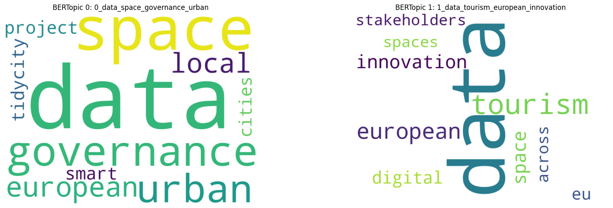
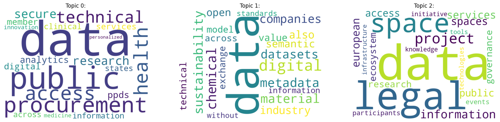
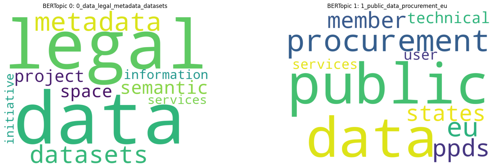

# Topic Modeling of European Data Spaces: Tourism vs Public Sector

Cross-sector analysis of **16 European data-space use cases** (10 tourism, 6 public sector) from the Data Spaces Radar, combining an **actor analysis** with **topic modeling** (TF-IDF, LDA and BERTopic) to compare how the two sectors frame their data ecosystems.

> Group project – Digital Ecosystems course, MSc Data Science and Management, LUISS Guido Carli (2025–2026)



## Key findings

| | Tourism | Public sector |
|---|---|---|
| **Dominant theme** | European coordination, governance and innovation | Operational data access: procurement, health, research |
| **Technical theme** | Secure data exchange and interoperability | Scientific and industrial data (chemicals, sustainability) |
| **Distinctive theme** | Urban and city-level applications | Legal and institutional frameworks |
| **Actors** | Mostly private, regional and national | Mostly public, international |

- Both sectors share a strong focus on **European coordination** and **structured data infrastructures**
- **Tourism** frames data spaces as tools for strategic positioning, innovation and territorial integration
- **Public sector** is anchored in legal structures, administrative systems and regulation
- **LDA vs BERTopic:** BERTopic gives more coherent clusters in tourism, while LDA keeps a specialised technical topic (chemicals, sustainability) that BERTopic treats as outliers

## Method

1. **Data collection** – texts collected manually from the official pages of each use case listed on the Data Spaces Radar, plus technical reports when available
2. **Preprocessing** – lowercasing, tokenization, removal of English stop words
3. **TF-IDF filtering** – the highest-scoring terms per document were mostly use-case names, acronyms and places (e.g. *datahub*, *tirol*, *omicspace*, *chem-x*). They were removed as custom stop words so the models capture **sector-level** themes rather than document-specific ones
4. **LDA** (gensim) – baseline bag-of-words model; number of topics chosen with the elbow of log-perplexity (k = 2–7) → **k = 3** in both sectors
5. **BERTopic** – transformer embeddings, UMAP, HDBSCAN and c-TF-IDF; the number of topics is set automatically by the clustering

## Results

### LDA (k = 3)

**Tourism**

| Topic | Share of documents | Top words |
|---|---|---|
| 0 · European tourism data governance and innovation | 60% | data, tourism, european, space, governance, digital, innovation |
| 1 · Secure digital data systems | 30% | data, digital, systems, core, trust, exchange, secure |
| 2 · Urban trust and data access | 10% | urban, data, project, trust, access, images, city |

**Public sector**

| Topic | Share of documents | Top words |
|---|---|---|
| 0 · Health data access, research and procurement | 50% | data, public, procurement, access, health, technical, research |
| 1 · Digital sustainability and scientific data management | 33% | data, digital, chemical, sustainability, metadata, material, datasets |
| 2 · Legal and institutional data frameworks | 17% | data, legal, space, project, information, services, european |



### BERTopic

**Tourism** – 2 topics, 2 outlier documents

| Topic | Documents | Top words |
|---|---|---|
| 0 · European tourism data governance and territorial coordination | 4 | data, space, governance, urban, european, local, project |
| 1 · Tourism data space innovation and European integration | 4 | data, tourism, european, innovation, space, digital, eu |

**Public sector** – 2 topics, 2 outlier documents

| Topic | Documents | Top words |
|---|---|---|
| 0 · Legal and semantic data infrastructure frameworks | 2 | data, legal, metadata, datasets, semantic, space, project |
| 1 · Public procurement and administrative data systems | 2 | public, data, procurement, eu, ppds, member, states |



## Actor analysis

174 actors classified by role, public/private, size, geographical level and type of legitimacy (`data/actors_analysis.xlsx`).

| | Tourism | Public sector |
|---|---|---|
| Use cases | 10 | 6 |
| Actors | 134 | 40 |
| Public / private | 41 / 93 | 23 / 17 |
| Large / medium / small | 70 / 24 / 40 | 25 / 14 / 1 |
| Most common role | Complementor (47) | Data provider (15) |
| Most common geographical level | Regional (62) | International (16) |
| Most common legitimacy | Knowledge-based (73) | Pragmatic (16) |

## Use cases analysed

**Tourism:** Data Space Traffic Measurements · datahub.tirol · Dates · DEPLOYTOUR · EONA-X · DS4SSCC · Tidy City · TOURiLab-SDG · truzzt box · UiTwisselingsplatform

**Public sector:** INESData · OmicSpace · DataFinland · Manufacturing-X (Chem-X) · Public Procurement Data Space (PPDS) · Once-Only Technical System (OOTS)

## Repository structure

```
├── data/
│   ├── tourism.txt              # texts of the 10 tourism use cases
│   ├── public_sector.txt        # texts of the 6 public-sector use cases
│   └── actors_analysis.xlsx     # actor classification
├── notebooks/
│   ├── 01_tourism.ipynb         # TF-IDF, LDA and BERTopic – tourism
│   └── 02_public_sector.ipynb   # TF-IDF, LDA and BERTopic – public sector
├── images/
└── requirements.txt
```

## How to run

```bash
git clone https://github.com/elisapresciutti/digital-ecosystems-topic-modeling.git
cd digital-ecosystems-topic-modeling
pip install -r requirements.txt
jupyter notebook notebooks/
```

BERTopic downloads a sentence-transformer model on first run, so an internet connection is needed.

## Tech stack

Python · NLTK · gensim · BERTopic · UMAP · HDBSCAN · scikit-learn · pandas · Matplotlib · seaborn · WordCloud · Plotly

## Limitations

- Small corpora (10 and 6 documents): topics describe these use cases, not whole sectors
- Texts differ in length and source type (web pages, reports)
- With so few documents BERTopic labels some use cases as outliers

---

*Source of use cases: Data Spaces Radar. Repository maintained by Elisa Presciutti · [LinkedIn](https://www.linkedin.com/in/elisapresciutti)*
